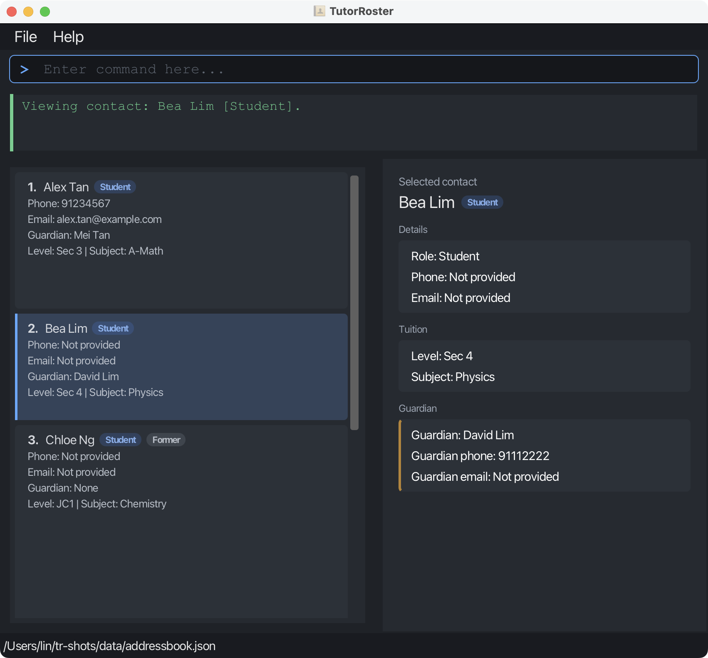
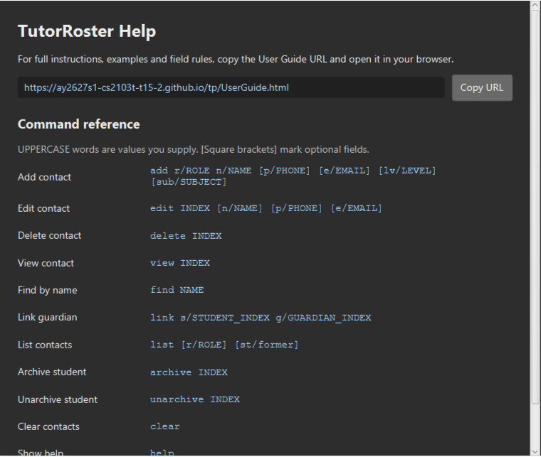
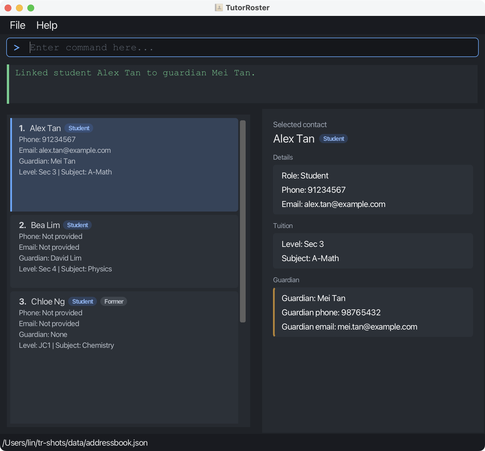

# TutorRoster User Guide

TutorRoster is a **desktop contact-management application for independent private tutors** managing a small group of
secondary school or junior college students and their guardians. Typed commands help tutors keep contact details
up to date and retrieve them quickly, with a graphical contact list and a panel for the selected contact's details.

<!-- * Table of Contents -->
<page-nav-print />

--------------------------------------------------------------------------------------------------------------------

## Quick start

1. Ensure that Java `25` or later is installed on your computer.<br>
   **Mac users:** Ensure you have the precise JDK version prescribed [here](https://se-education.org/guides/tutorials/javaInstallationMac.html).

1. Download the latest `.jar` file from [here](https://github.com/AY2627S1-CS2103T-T15-2/tp/releases).

1. Copy the file to the folder you want to use as the _home folder_ for your TutorRoster.

1. Open a terminal, `cd` to the folder containing the JAR file, and run `java -jar tutorroster.jar`.<br>
   The application opens with your saved contacts, or an empty list if there is no data file yet.<br>
   

1. Type a command in the command box and press Enter to execute it. For example, type **`help`** and press Enter to open the help window.<br>
   Some example commands you can try:

   * `list` : Lists guardians and active students.

   * `add r/student n/John Doe p/98765432 e/johnd@example.com` : Adds a student named `John Doe`.

   * `delete 3` : Deletes the 3rd contact shown in the current list.
   * `delete 1 3 5` : Deletes the 1st, 3rd and 5th contacts in one operation.

   * `clear` : Deletes all contacts.

   * `exit` : Exits the app.

1. Refer to the [Features](#features) section below for details of each command.

--------------------------------------------------------------------------------------------------------------------

## Features

<box type="info" seamless>

**Notes about the command format:**<br>

* Words in `UPPER_CASE` are the parameters to be supplied by the user.<br>
  For example, in `add n/NAME`, replace `NAME` with a value such as `John Doe`.

* Items in square brackets are optional.<br>
  For example, `edit INDEX [n/NAME] [p/PHONE]` can be used as `edit 1 n/John Doe` or as `edit 1 p/91234567`.

* Parameters can be in any order.<br>
  For example, if the command specifies `n/NAME p/PHONE`, `p/PHONE n/NAME` is also acceptable.

* Extraneous parameters for commands that take no parameters, such as `help`, `exit`, and `clear`, are ignored.<br>
  For example, `help 123` is interpreted as `help`.

* If you are using a PDF version of this document, be careful when copying and pasting commands that span multiple lines as space characters surrounding line-breaks may be omitted when copied over to the application.
</box>

<box type="info" seamless>

**Contact order:**<br>

* Contacts are always displayed in alphabetical order of name, ignoring capitalization.
* Contacts with the same name are displayed with guardians before students.
* Accented letters are ordered with their unaccented forms, so `Élise Tan` is displayed between `Edward Lim` and
  `Felix Ng`. Letters without a separate accent mark are also ordered with the letters they are based on: `ø` with
  `o`, `ł` with `l`, `æ` with `ae` and `ß` with `ss`. A name without accents is displayed before the same
  name with accents.
* Index numbers used by commands such as `edit` and `delete` refer to this displayed order.
</box>

### Viewing help: `help`

Opens a command reference listing the available commands and their formats. For full instructions, examples and
field rules, use **Copy URL** to copy the User Guide link and open it in your browser.
The Help window can be resized and scrolled.



Format: `help`

### Adding a contact: `add`

Adds a student or guardian contact.

Format: `add r/ROLE n/NAME [p/PHONE] [e/EMAIL] [lv/LEVEL] [sub/SUBJECT]`

**Role and name are required.** Students may have phone, email, both, or neither. Guardians must have at least
one contact method. Level and subject are optional and available **only for students**.

Examples:

| To add... | Enter |
| --- | --- |
| A student with phone and email | `add r/student n/Alex Tan p/91234567 e/alex@example.com` |
| A student with level and subject | `add r/student n/Alex Tan lv/Sec 3 sub/Math` |
| A student without contact details | `add r/student n/Ben Lim` |
| A guardian with email only | `add r/guardian n/Mei Tan e/mei@example.com` |
| A student whose name contains `/` | `add r/student n/"Ravi s/o Kumar" p/98765432` |

Use lowercase `add` and prefixes (`r/`, `n/`, `p/`, `e/`, `lv/`, `sub/`). Parameters may appear in any order,
once each. Omit an optional field's prefix if unused; an empty prefix such as `p/` is rejected.
Whitespace before a prefix, including pasted tabs or line breaks, separates parameters just like a space.
Whitespace inside a value follows that field's rules; for example, a tab inside a phone number is rejected.
Omitted phone and email values display as `Not provided`.

On success, the contact is saved and selected, and its details appear in the detail panel. Guardians and active
students are shown, clearing any search or list filter. Former students remain hidden. The command box clears and
stays focused. The first example reports `Added contact: Alex Tan [Student].`

#### Field rules

Surrounding whitespace is removed from field values. Capitalization is preserved for names, emails, levels and subjects.

**Role (`r/`)**: `student` or `guardian`, ignoring letter case.

**Name (`n/`)**: A non-blank name of **1 to 70 characters**, allowing letters and numbers (including non-English
scripts), spaces, apostrophes (`'` or `’`), hyphens, periods, and slashes. Consecutive spaces become one space
before the length check. Enclose the **entire name** in double quotes if it contains `/`, even for `n/"AC/DC"`.
The enclosing quotes are not saved; surrounding whitespace inside them is also removed.
Use straight double quotes (`"`), with no extra text outside them. Prefix-like text inside a quoted name stays
part of the name: `n/"Ravi p/e ratio"` does not supply a phone number. Quotes protect names only, not other fields.

**Phone (`p/`)**: At least **3 digits from `0-9`**, with a maximum of **100 characters**. Other numerals are allowed
as text but do not count. Labels, multiple numbers, spaces, and punctuation are accepted, for example
`p/(HP) +65 1234 5678 1111-3333 (Office)`. The `+` may appear anywhere. Do not include `@`, `/`, or control
characters such as tabs and line breaks.

**Email (`e/`)**: At most **254 characters**. TutorRoster checks the format, not whether the mailbox exists:

* Exactly one `@`, a non-empty part on each side, and no internal whitespace.
* Before `@`: English letters (`A-Z`, `a-z`), digits (`0-9`), and `.`, `_`, `%`, `+`, or `-`.
  The local part is limited to **64 characters**. Punctuation must appear singly between letters or digits,
  as in `alex+tuition@example.com`.
* After `@`: at least two non-empty labels separated by periods, as in `example.com`. Labels allow English
  letters, digits, and single hyphens between letters or digits. Each label is limited to **63 characters**.
  The final label needs at least two characters.

Common email mistakes:

| Invalid input | Reason |
| --- | --- |
| `alex @example.com` | Internal whitespace. |
| `@example.com` | Missing part before `@`. |
| `alex@.com` or `alex@example..com` | Empty domain label. |
| `alex@example` or `alex@example.c` | Missing second label or final label too short. |
| `.alex@example.com` or `alex..tan@example.com` | Invalid punctuation placement. |

**Level (`lv/`) and subject (`sub/`)**: One value each, for students only. Each must contain **1 to 30 characters**,
including at least one letter or digit. Letters and digits (including non-English scripts), spaces, hyphens,
periods, plus signs, and parentheses are allowed. Repeated spaces become one space before checking length.
Examples: `lv/Sec 3`, `sub/A-Math`. The value `NONE`, ignoring case, is reserved for removing fields with `edit`.

#### Duplicate contacts and warnings

Checks include **all saved contacts**, including former students and contacts hidden by a filter. These rules
apply to contacts with the **same role and name**, ignoring name capitalization. Level and subject do not affect
these checks.

| Condition, checked in this order | Result |
| --- | --- |
| Phone and email both match, with at least one contact method present | Rejected: `This contact already exists.` |
| Phone matches after spaces and hyphens are removed | Added with a phone warning. |
| Email matches, ignoring capitalization | Added with an email warning. |
| Phone is missing from both contacts, or email is missing from both | Added with a general warning. |
| None of the above | Added without a warning. |

Exact duplicates ignore email capitalization and treat two omitted values as matching. **Internal phone spaces and
hyphens remain significant for rejection**: `p/9123 4567` and `p/91234567` produce a warning instead.

Two students named `Ben Lim` with no phone or email are both saved, with a general warning for the second.
Different roles or names trigger no duplicate checks. Only the highest-priority warning is shown, after the success
message; **a warning does not prevent saving**.

#### Correcting an unsuccessful add

Missing required fields, empty values, repeated parameters, and unknown prefixes such as `a/15` are rejected.
A missing role or name error identifies the field and shows the command format. Unknown-parameter errors identify
the invalid prefix and list valid ones; repeated-parameter errors name the repeated prefix. A slash in an unquoted
name also prompts you to quote the entire name.

After parameter syntax checks, field values are checked in the order `r/`, `n/`, `p/`, `e/`, `lv/`, `sub/`.
For example, `add p/12 n/Alex Tan r/teacher` reports the invalid role first.
For guardians, the contact-method requirement is checked after phone and email; any `lv/` or `sub/` is then rejected.

Other errors explain the reason, for example:

* `add r/guardian n/Mei Tan` reports `A guardian must have at least one contact method: phone or email.`
* `add r/guardian n/Mei Tan p/91234567 lv/Sec 3` reports
  `Only students can have a level or subject. Remove lv/ and sub/ when adding a guardian.`
* `add r/student n/Alex Tan p/` reports `Empty phone parameter: Phone cannot be empty when p/ is specified.`
* `add r/student n/Alex Tan sub/---` reports `Subject must contain at least one letter or digit.`

Level and subject errors distinguish excessive length, unsupported characters and values without any letters or
digits. Email errors distinguish unsupported characters from punctuation placement, such as consecutive periods.

Correct the indicated problem and try again. On failure, contacts, selection, and saved data stay unchanged;
the command remains for correction. For saving errors, see [Saving the data](#saving-the-data).

### Listing contacts: `list`

Shows guardians and active students, or only the contacts you choose.

Format: `list [r/ROLE] [st/STATUS] [lv/LEVEL] [sub/SUBJECT]`

Command | Shows
--------|------
`list` | Guardians and active students
`list r/student` | Active students only
`list r/guardian` | Guardians only
`list st/former` | Former students only
`list st/all` | Every contact, including former students
`list r/student st/all` | All students, active and former
`list lv/Sec 3` | Active students at level Sec 3
`list lv/Sec 3 sub/A-Math` | Active Sec 3 students who take A-Math
`list sub/Physics st/all` | All students who take Physics, active and former

* `list` shows all guardians and active students. Former students are hidden; see
  [Marking a student as former](#marking-a-student-as-former-archive).
* `r/ROLE` shows only contacts with that role. `ROLE` must be `student` or `guardian`, and ignores letter case.
* `st/STATUS` chooses which contacts to show by status. `STATUS` must be `active`, `former` or `all`, and ignores
  letter case:
  * `st/active` shows guardians and active students. This is the default, so `list st/active` is the same as `list`.
  * `st/former` shows only former students.
  * `st/all` shows every contact, whatever its status.
* `lv/LEVEL` and `sub/SUBJECT` show only students with that level and subject. Letter case and spaces are
  ignored, so `lv/sec3` matches a student at `Sec 3`. The whole value must match: `sub/Math` does not match
  `A-Math`. Students without a level or subject are not shown. `LEVEL` and `SUBJECT` follow the same rules as in
  `add`, and `NONE` cannot be used.
* Parameters can be given in any order, and each can appear only once. A contact must match all of them.
  Without `st/`, former students are hidden, so add `st/all` to include them.
* Guardians are never former, so `list r/guardian st/former` is rejected with
  `Guardians cannot be former. Remove r/guardian or st/former.`
* Guardians have no level or subject, so `list r/guardian lv/Sec 3` is rejected with
  `Guardians have no level or subject. Remove r/guardian, or remove lv/ and sub/.`
* TutorRoster also starts with guardians and active students shown.
* Any other text after `list` is rejected; for example, `list 3` shows
  `Invalid list command. Use: list [r/ROLE] [st/STATUS] [lv/LEVEL] [sub/SUBJECT]`. If you type a role or status
  without its prefix, the message suggests the right command; for example, `list former` shows
  `Invalid list command. Did you mean: list st/former?`
* An invalid role is rejected with `Invalid role. Role must be student or guardian.`, an invalid status with
  `Invalid status. Status must be active, former, or all.`, and repeating a parameter with
  `Each of r/, st/, lv/ and sub/ may appear only once.` An invalid level or subject gets the same error as in
  `add`; for example, `list lv/` shows `Empty level parameter: Level cannot be empty when lv/ is specified.`
* If several parameters are invalid, only the first error is shown, in the order `r/`, `st/`, `lv/`, `sub/`.
* The result shows the number of contacts listed; for example, `Listed 6 contacts` or `Listed 2 former students`.
  When the list hides former students that would otherwise be shown, the result also says how many; for example,
  `Listed 6 contacts. 2 former students hidden. Add st/all to include them.`
* If there are no saved contacts, `No contacts found.` is shown. If every saved contact is a former student,
  `No active contacts found. Use list st/former to see former students.` is shown. If there are no former students,
  `list st/former` shows `No former students found.`
* If no student has the chosen level or subject, `No contacts found.` is shown. If former students would match,
  the result also says how many are hidden; for example,
  `No contacts found. 1 former student hidden. Add st/all to include them.`
* If no contact has the chosen role, `list r/guardian` shows `No guardians found.` and `list r/student` shows
  `No students found.` If every student is former, `list r/student` shows
  `No active students found. Use list r/student st/former to see former students.`
* Each contact is shown with its index, name and role, phone number, and email address. Students also show
  their linked guardian. For example:
  ```
  1. Alex Tan [Student]
  Phone: 91234567
  Email: alex@example.com
  Guardian: Mei Tan
  ```
* If a student has no linked guardian, `Guardian: None` is shown.
* If a contact has no phone number or email address, `Not provided` is shown instead; for example, `Phone: Not provided`.
* If a student has a level or subject, their card shows both on one line, for example
  `Level: Sec 3 | Subject: Math`. A missing value is shown as `Not set`, for example
  `Level: Sec 3 | Subject: Not set`. The line is hidden when both fields are missing.
* Selecting a student shows separate `Level:` and `Subject:` lines in the details panel. Each missing value is shown
  as `Not set`. Guardians do not show level or subject details.
* A former student is labelled `[Former]` after their role, for example `Alex Tan [Student] [Former]`, and the
  details panel shows `Role: Student [Former]`.

### Marking a student as former: `archive`

Marks a student who no longer takes lessons as a former student, so that they are hidden from `list`.

Format: `archive INDEX`

* `INDEX` is the index shown in the displayed contact list, and must be a positive integer 1, 2, 3, ...
* The student keeps their details and guardian link. Their guardian stays in `list`.
* The displayed list is kept and refreshed. After `list`, the student disappears straight away; after `find`, they
  stay in the results, labelled `[Former]`. The result names the student; for example,
  `Marked Alex Tan as a former student.`
* Only students can be archived. Archiving a guardian is rejected with `Only students can be archived.`
* Archiving a student who is already former is rejected with `Alex Tan is already a former student.`
* An index larger than the displayed list is rejected with `No contact exists at index INDEX.`

Examples:
* `list` followed by `archive 2` marks the 2nd contact in the list as a former student.
* `find Alex` followed by `archive 1` marks the 1st search result as a former student.

### Marking a former student as active: `unarchive`

Marks a former student as active again, for example when they return for lessons.

Format: `unarchive INDEX`

* Run `list st/former` or `find NAME` first, since former students are hidden from `list`.
* The displayed list is kept and refreshed. After `list st/former`, the student disappears straight away; after
  `find`, they stay in the results without the `[Former]` label. The result names the student; for example,
  `Marked Alex Tan as an active student.`
* Only students can be unarchived. Unarchiving a guardian is rejected with `Only students can be unarchived.`
* Unarchiving a student who is already active is rejected with `Alex Tan is already an active student.`
* Index rules are the same as for `archive`.

Examples:
* `list st/former` followed by `unarchive 1` marks the 1st former student as active again.

### Editing a contact: `edit`

Edits an existing contact.

Format: `edit INDEX [n/NAME] [p/PHONE] [e/EMAIL] [lv/LEVEL] [sub/SUBJECT]`

* Edits the contact at the specified `INDEX`. The index refers to the index number shown in the displayed contact list. The index **must be a positive integer** 1, 2, 3, ...
* At least one of the optional fields must be provided.
* Existing values will be updated to the input values.
* After a successful edit, the edited contact is selected and its details are shown in the details panel.
  Editing a former student shows `list st/former`, and editing any other contact shows `list`, so the edited contact
  stays visible.
* Omitting `e/` preserves the existing email, including its absence. Supplying an email uses the same validation
  as `add`. An empty `e/` is rejected.
* `e/NONE` removes the existing email. `NONE` ignores letter case, so `e/none` also works.
* Omitting `p/` preserves the existing phone number, including its absence. Supplying a phone number uses the same
  validation as `add`. An empty `p/` is rejected.
* `p/NONE` removes the existing phone number. As with `e/NONE`, letter case is ignored.
* A guardian must keep at least one contact method. An edit that would leave a guardian with neither a phone number
  nor an email is rejected with `A guardian must have at least one contact method: phone or email.`
  A student can have both removed.
* `lv/LEVEL` and `sub/SUBJECT` set a student's level and subject, using the same rules as `add`. `lv/NONE` and
  `sub/NONE` remove them, ignoring letter case. Omitting either keeps the existing value. Editing the level or subject
  of a guardian is rejected with
  `Only students can have a level or subject. Remove lv/ and sub/ when editing a guardian.`
* A name containing a word that ends in `/`, such as `s/o`, must be wrapped in double quotes. Anything inside the
  quotes is treated as part of the name, so `edit 1 n/"Randy p/e ratio"` sets the name to `Randy p/e ratio` without
  reading `p/` as a phone. Unquoted, `edit 1 n/Ravi s/o Kumar` is rejected because `s/` is read as a parameter.
  Unlike `add`, `edit` accepts embedded slashes without quotes, for example `edit 1 n/AC/DC`.
* Each of `n/`, `p/`, `e/`, `lv/` and `sub/` may appear only once. Any other parameter, such as `r/` or `a/`, is
  rejected with `Unknown parameter. Use: edit INDEX [n/NAME] [p/PHONE] [e/EMAIL] [lv/LEVEL] [sub/SUBJECT]`.
  The role of a contact cannot be edited.
* A missing index, or extra text before the first parameter, is rejected with
  `Invalid edit command. Use: edit INDEX [n/NAME] [p/PHONE] [e/EMAIL] [lv/LEVEL] [sub/SUBJECT]`.
* An index that is not a positive whole number is rejected with
  `The contact index must be a positive integer shown in the list.` Leading zeroes are accepted, so `02` means 2.
  An index larger than the displayed list is rejected with `No contact exists at index INDEX.`
* An edit that would make the contact identical to another contact is rejected with
  `This edit would create a duplicate contact.`
* If the edited contact has the same role and name as another contact, and the two also share a phone number,
  an email address, or a missing phone number or email, the edit still goes ahead but a warning is shown below the
  success message, as with `add`. For example, renaming a student to the name of another student with the same phone
  number but a different email shows `Warning: Another contact with the same role and name, and a phone number
  matching after ignoring spaces and hyphens exists. This contact may be a duplicate, but it was updated.`

Examples:
*  `edit 1 p/91234567 e/johndoe@example.com` Edits the phone number and email address of the 1st contact to be `91234567` and `johndoe@example.com` respectively.
*  `edit 2 n/Betsy Crower` Edits the name of the 2nd contact to be `Betsy Crower`.
*  `edit 2 e/NONE` Removes the email of the 2nd contact.
*  `edit 2 p/NONE` Removes the phone number of the 2nd contact.
*  `edit 3 lv/Sec 4 sub/NONE` Changes the level of the 3rd contact, a student, to `Sec 4` and removes their subject.
*  `edit 3 n/"Ravi s/o Kumar"` Edits the name of the 3rd contact to be `Ravi s/o Kumar`.

### Locating contacts by name: `find`

Finds contacts whose names contain the given `NAME`.

Format: `find NAME`

* The search is case-insensitive; for example, `hans` matches `Hans`.
* Partial names match; for example, `Han` matches `Hans`.
* `NAME` is matched as a whole, so word order matters; for example, `Hans Bo` matches `Hans Bonnie` but not `Bo Hans`.
* Leading and trailing spaces are ignored, and consecutive spaces are treated as one space.
* Curly and straight apostrophes are treated as the same; for example, `o'brien` matches `O’Brien`.
* Accents are ignored; for example, `elise` matches `Élise`, `élise` matches `Elise`, and `soren` matches `Søren`.
* The search considers only names.
* Former students are included in the results, labelled `[Former]`.
* `NAME` cannot be blank; `find` with no name shows `Invalid find command. Use: find NAME`.
* The result shows the number of matches; for example, `Found 2 contacts matching: li.`
* If no contact matches, `No contacts found matching: NAME` is shown.
* Matching contacts are shown in the same format as `list`.

Examples:
* `find ale` returns `Alex Yeoh`
* `find li` returns `Charlotte Oliveiro` and `David Li`

### Viewing a contact's details: `view`

Shows the full details of the specified contact in the details panel.

Format: `view INDEX`

* Shows the details of the contact at the specified `INDEX` in the details panel, and selects that contact in the list.
* The index refers to the index number shown in the displayed contact list.
* The index **must be a positive integer** 1, 2, 3, ...
* A value that is not a positive integer is rejected with
  `The contact index must be a positive integer shown in the list.`
* An index outside the displayed list is rejected with `No contact exists at index INDEX.`
* The details panel shows the contact's name with a `Student` or `Guardian` badge, and a `Former` badge for a former
  student. Below the name, the details panel groups the contact's details into sections:
  * **Details**: the contact's role, phone number and email address.
  * **Tuition** (students only): the student's level and subject.
  * **Guardian** (students only): the linked guardian's name, phone number and email address, or `Guardian: None` if
    no guardian is linked.
* `view` also works on the results of `list st/former`, `list st/all` and `find`. A former student's role is shown as
  `Role: Student [Former]`.
* The displayed list does not change, so you can keep using the same indexes afterwards.
* The result names the contact; for example, `Viewing contact: Alex Tan [Student].`

Examples:
* `list` followed by `view 2` shows the details of the 2nd contact in the displayed contact list.
* `find Alex` followed by `view 1` shows the details of the 1st contact in the results of the `find` command.

### Linking a student to a guardian: `link`

Format: `link s/STUDENT_INDEX g/GUARDIAN_INDEX`

* Run `list` or `find NAME` first and use the indexes in the **currently displayed list**.
* Both contacts must be visible. If a search hides either contact, run `list` before linking an active student.
  To link a former student without reactivating them, use `list st/all` to show both contacts, or `find NAME` with a
  search term that shows both; for example, `find Tan` can show former student Alex Tan and guardian Mei Tan
  together.
* `s/` must identify a student and `g/` must identify a guardian.
* Indexes must be positive whole numbers. Leading zeroes are accepted: `02` means `2`.
* Parameters may appear in either order; each must appear exactly once. Command words and prefixes are case-sensitive.
* Each student can have one guardian; a guardian can be linked to several students.
* Students with the same name remain separate contacts, even if both have no phone or email.
  Use the intended student's displayed index; linking one does not change the other student's guardian.
* Linking to a different guardian replaces the previous relationship. Linking to the same guardian again is rejected.
* A successful command selects the student and shows the guardian's current name, phone and email in the detail panel.
  The command box stays focused so you can immediately enter the next command.
* The relationship is saved automatically and survives edits, reordering and restarting the application.

Examples, assuming Alex Tan is student `1`, Mei Tan is guardian `2`, and Sarah Lim is guardian `3`:

* `link s/1 g/2` shows `Linked student Alex Tan to guardian Mei Tan.`
* `link g/2 s/1` has the same effect, but is rejected if that relationship already exists: `Alex Tan is already linked to Mei Tan.`
* `link s/1 g/3` replaces Mei Tan and shows `Changed Alex Tan’s guardian from Mei Tan to Sarah Lim.`

Common errors:

| Input problem | Result |
|---|---|
| Missing parameter or extra text | `Invalid link command. Use: link s/STUDENT_INDEX g/GUARDIAN_INDEX` |
| Unknown parameter | `Unknown parameter. Use: link s/STUDENT_INDEX g/GUARDIAN_INDEX` |
| Repeated parameter | `Each of s/ and g/ may appear only once.` |
| Invalid student index | `Student index must be a positive integer shown in the list.` |
| Invalid guardian index | `Guardian index must be a positive integer shown in the list.` |
| Student index outside the displayed list | `No contact exists at student index INDEX.` |
| Guardian index outside the displayed list | `No contact exists at guardian index INDEX.` |
| Wrong student role | `Student index must refer to a student.` |
| Wrong guardian role | `Guardian index must refer to a guardian.` |

Failed link commands leave the contacts, relationships, selected contact, detail panel and saved data unchanged.



### Deleting contacts: `delete`

Deletes one or more specified contacts from TutorRoster.

Format: `delete INDEX [INDEX...]`

Alternatively, delete one contact by full name: `delete n/NAME`.

* Name matching ignores letter case and repeated or surrounding spaces. Accents, punctuation and word order
  must match. Partial names do not match.
* Only the currently displayed contacts are searched. Use `list`, `find NAME` or `list st/former` first to
  display the intended contact.
* Exactly one displayed contact must match. If none match, the error is
  `No displayed contact matches name: NAME.`
* If multiple contacts match, no contact is deleted. The error lists their displayed indexes and roles;
  use `delete INDEX` to choose the intended contact.
* An empty name is rejected. Supply one `n/NAME` parameter and do not combine it with index targets.
  Digits after `n/` are part of the name, for example `delete n/Alex 2` searches for the full name `Alex 2`.
* Deletion by name uses the same relationship cleanup and automatic saving as deletion by index.
  Failed commands or failed saves leave the contacts and saved data unchanged.

* Deletes the contacts at the specified indexes.
* Each index refers to the index number shown in the displayed contact list.
* Each index **must be a unique positive integer** 1, 2, 3, ...
* The indexes can be supplied in any order. They always refer to the original displayed list, so deleting one contact
  does not change which other contacts the command deletes.
* The command is atomic. If any index is invalid, repeated or outside the displayed list, no contacts are deleted.
* A value that is not a positive integer is rejected with
  `The contact index must be a positive integer shown in the list.`
* A repeated index is rejected with `Each contact index may appear only once.`
* An index outside the displayed list is rejected with `No contact exists at index INDEX.`

Deleting an unlinked contact does not remove any student-guardian relationships. Deleting a linked student removes
that student's relationship while retaining the guardian. Deleting a guardian clears the relationships of all students
linked to that guardian while retaining those student contacts.

The success message reports how many relationships were removed, when applicable:

* Deleting an unlinked contact: `Deleted contact: Alex Tan [Student].`
* Deleting a linked student: `Deleted contact: Alex Tan [Student]. Removed 1 student-guardian relationship.`
* Deleting a guardian linked to one student: `Deleted contact: Mei Tan [Guardian]. Removed 1 student-guardian relationship.`
* Deleting a guardian linked to two students: `Deleted contact: Mei Tan [Guardian]. Removed 2 student-guardian relationships.`
* Deleting several contacts lists each deleted contact. If both a student and that student's guardian are deleted,
  their relationship is counted once.

Students without a guardian show `Guardian: None` in the detail panel.

Examples:
* `list` followed by `delete 2` deletes the 2nd contact in the displayed contact list.
* `list` followed by `delete 1 3 5` deletes the 1st, 3rd and 5th displayed contacts.
* `list` followed by `delete n/Alice Tan` deletes Alice Tan if exactly one displayed contact matches.
* `delete n/  alice   tan` also matches `Alice Tan`.
* `find Betsy` followed by `delete 1` deletes the 1st contact in the results of the `find` command.
* `list st/former` followed by `delete 1` deletes the 1st former student in the displayed list. If that student
  is linked to a guardian, the student-guardian relationship is also removed, but the guardian contact is kept.

### Undoing the latest deletion: `undo`

Format: `undo`

* Restores the latest successful deletion by index, multiple indexes or name, including original contact IDs,
  details and student-guardian links. Bulk deletion is restored as one operation.
* Restores the filter used before deletion and selects a restored contact visible in that view.
* Read-only commands such as `list`, `find` and `view` preserve undo availability.
* Another successful deletion replaces the undo opportunity. Any other successful data-changing command clears it.
* Failed commands and failed saves preserve the undo opportunity. If saving an undo fails, no data changes are
  applied and you can retry `undo`.
* History lasts only for the current session. Successful undo consumes it; there is no redo.
* If nothing can be undone, the message is `No deletion is available to undo.` Extra arguments are rejected.

Example: `delete 1 3`, followed by `undo`, restores both deleted contacts and their original relationships.

### Reviewing contact data: `check`

Format: `check [guardians|details|duplicates]`

Checks the currently displayed contacts and reports suggestions without changing data, saving a file or resetting
the view. Running this command does not invalidate deletion undo. Run `list`, `find NAME` or `list st/former`
first to choose the contacts to inspect.

* `check` includes all three sections; `check guardians` reports students without linked guardians.
* `check details` reports missing level or subject for students and missing contact methods when both phone and
  email are absent. Guardians are not expected to have student details.
* `check duplicates` reports pairs using the same warning rules as `add` and `edit`: the same name and role plus
  matching phone numbers, matching emails, or a shared absent phone/email field. Phone comparison ignores spaces
  and hyphens; email comparison ignores letter case. Different roles are not treated as duplicates.
* Duplicate comparison considers only the displayed contacts. A guardian hidden by a filter is still recognized
  through the student's saved link and is not reported as missing.
* Results use the current displayed indexes and label former students. Missing optional values and duplicate
  warnings are suggestions, not proof of incorrect data. Inspect contacts before deciding to edit, link or delete.
* Section names ignore case. Unknown sections or multiple sections are rejected with
  `Use check [guardians|details|duplicates].` An empty view reports that no displayed contacts can be checked.

Example: run `find Tan`, then `check duplicates` to review matching displayed pairs.

### Clearing all entries: `clear`

Clears all contacts from TutorRoster.

Format: `clear`

### Exiting the program: `exit`

Exits the program.

Format: `exit`

### Saving the data

TutorRoster automatically saves successful `add`, `edit`, `delete`, `clear`, `link`, `archive` and `unarchive` commands.
You do not need to save manually. Read-only commands do not write the data file.

If saving fails, the command reports `Changes could not be saved. No changes were made.` Contacts, relationships and the previously saved data remain unchanged.

### Editing the data file

TutorRoster data is saved automatically as a JSON file `[JAR file location]/data/addressbook.json`. Advanced users are welcome to update data directly by editing that data file.

<box type="warning" seamless>

**Caution:**
If the data file is invalid, TutorRoster starts with an empty list and disables data-changing commands for that session. It displays `Data changes are disabled because the data file could not be loaded. Fix the file and restart TutorRoster.` The invalid file is preserved. Back up the file before editing it, fix the error and restart the application.<br>
Contacts have permanent `id` values, and a student's optional `guardianId` must refer to an existing guardian's `id`. Keep IDs unique and preserve them when editing contact details. Invalid IDs, repeated JSON fields, duplicate contacts and invalid guardian references make the file invalid. Older valid files without IDs are accepted; IDs are assigned on loading and included in the next successful save.
</box>

### Archiving data files `[coming in v2.0]`

_Details coming soon ..._

--------------------------------------------------------------------------------------------------------------------

## FAQ

**Q**: How do I transfer my data to another computer?<br>
**A**: Transfer your saved contact-data file as follows:

1. Close TutorRoster on both computers before copying any files.
2. Back up `data/addressbook.json` from your existing TutorRoster home folder. If the destination computer already
   has TutorRoster data, back up its `data/addressbook.json` too, because copying will replace those contacts.
3. Download the JAR to your chosen TutorRoster home folder on the destination computer. Create a `data` subfolder
   there if it does not exist. A fresh installation does not create `addressbook.json` until a successful
   data-changing command, so you do not need to add a dummy contact first.
4. Copy the source `addressbook.json` into that destination `data` subfolder, keeping its filename. Copy the whole
   file without changing contact IDs or guardian IDs, so that guardian relationships are retained.
5. Open a terminal in the destination TutorRoster home folder and run `java -jar "tutorroster.jar"`. Launching from
   this folder ensures the relative data path refers to the file you copied. Check the contacts and guardian links;
   use `list st/former` to check former students as well.

--------------------------------------------------------------------------------------------------------------------

## Known issues

1. **If you minimize the Help Window** and then run the `help` command (or use the `Help` menu, or the keyboard shortcut `F1`) again, the original Help Window will remain minimized, and no new Help Window will appear. The remedy is to manually restore the minimized Help Window.

--------------------------------------------------------------------------------------------------------------------

## Command summary

Action     | Format, Examples
-----------|----------------------------------------------------------------------------------------------------------------------------------------------------------------------
**Add**    | `add r/ROLE n/NAME [p/PHONE] [e/EMAIL] [lv/LEVEL] [sub/SUBJECT]` <br> e.g., `add r/student n/James Ho p/22224444 e/jamesho@example.com lv/Sec 3 sub/Math`
**Clear**  | `clear`
**Check data** | `check [guardians|details|duplicates]`<br> e.g., `check`, `check duplicates`
**Delete** | `delete INDEX [INDEX...]` or `delete n/NAME`<br> e.g., `delete 3`, `delete 1 3 5`, `delete n/Alice Tan`
**Edit**   | `edit INDEX [n/NAME] [p/PHONE] [e/EMAIL] [lv/LEVEL] [sub/SUBJECT]`<br> e.g.,`edit 2 n/James Lee e/jameslee@example.com`
**Find**   | `find NAME`<br> e.g., `find alex`
**Link**   | `link s/STUDENT_INDEX g/GUARDIAN_INDEX`<br> e.g., `link s/1 g/2`
**List**   | `list [r/ROLE] [st/STATUS] [lv/LEVEL] [sub/SUBJECT]`<br> e.g., `list r/student`, `list st/former`, `list st/all`, `list lv/Sec 3 sub/A-Math`
**Archive** | `archive INDEX`<br> e.g., `archive 2`
**Unarchive** | `unarchive INDEX`<br> e.g., `unarchive 1`
**Undo deletion** | `undo`<br> Restores the latest successful deletion in the current session.
**View**   | `view INDEX`<br> e.g., `view 2`
**Help**   | `help`
